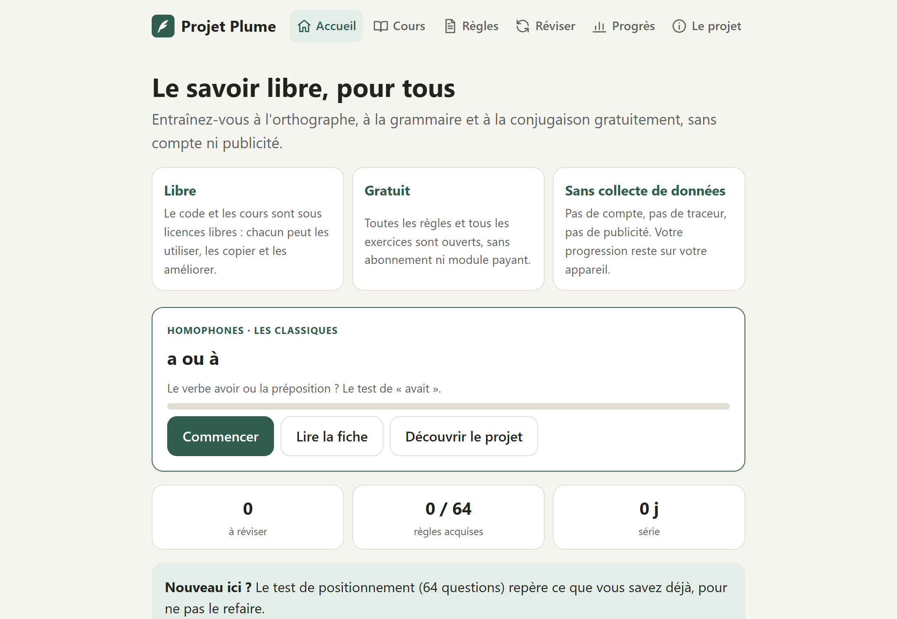
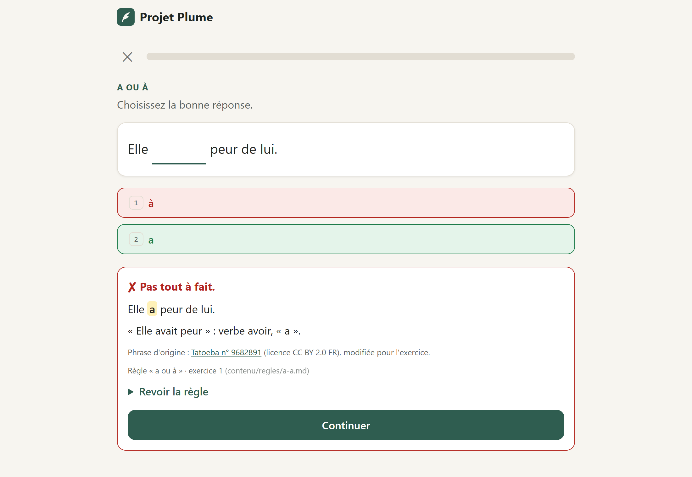
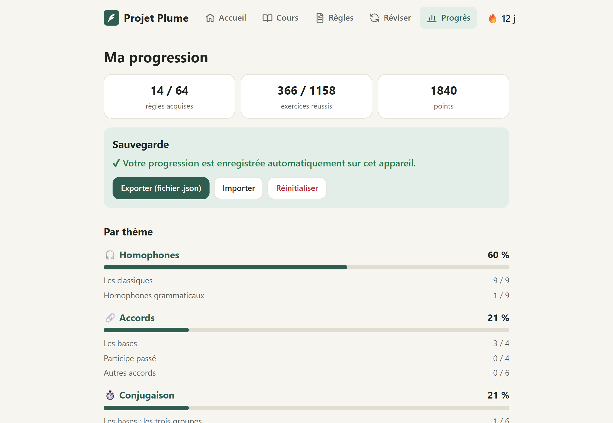

# La Plume de Diderot

*Projet Plume — l'orthographe libre et gratuite*

**Essayer en ligne : https://projet-plume.pages.dev**

<p align="center">
  
  
  
</p>

Application **gratuite et libre** d'entraînement à l'orthographe, à la grammaire et à la conjugaison françaises :

- **sans abonnement ni modules payants** : un seul parcours continu ;
- **sans compte, sans serveur, sans publicité** : la progression reste sur l'appareil ;
- **libre** : code sous GPL-3.0-or-later, contenu sous CC BY-SA 4.0 (et LGPL pour les phrases issues de LanguageTool).

> **Réalisé en grande partie avec une intelligence artificielle** (Claude, d'Anthropic), faute de moyens pour tout écrire à la main. Toute reprise, relecture ou réécriture humaine est bienvenue : c'est le but d'un projet libre.

> État : **en construction**. 64 règles et 1 158 exercices, du collège au niveau adulte. La liste de ce qui reste à écrire est dans [docs/FEUILLE-DE-ROUTE.md](docs/FEUILLE-DE-ROUTE.md).

## Démarrage rapide

Il faut **Python 3** et **Node.js**. Sur Windows, macOS ou Linux :

```bash
git clone https://github.com/Allesca/projet-plume.git
cd projet-plume
python -I outils/construire.py
python -I outils/servir.py
```

Puis ouvrir http://localhost:8000. (Selon le système, la commande peut s'appeler `python3`.)

- `construire.py` assemble les règles (`contenu/regles/*.md`) et écrit le site complet dans `publication/` : une page HTML par adresse (lisible sans JavaScript, pour les moteurs de recherche), `sitemap.xml`, `robots.txt`.
- `servir.py` se comporte comme Cloudflare Pages (adresses sans `.html`, retour à l'accueil pour les adresses inconnues). Ouvrir un fichier par double-clic ne fonctionne pas : les adresses du site sont absolues.
- **Raccourci Windows** : double-cliquez sur `Lancer Plume.bat`, qui fait les deux étapes et ouvre le navigateur. Laissez la fenêtre noire ouverte pendant l'utilisation.
- **Captures d'écran du README** : serveur lancé, puis `node outils/captures.js` (Chrome, Edge ou Chromium requis).

## Contribuer

Une erreur dans une règle, un exercice à proposer, une relecture ? Voir **[CONTRIBUTING.md](CONTRIBUTING.md)**. Pas besoin de savoir programmer : les règles sont de simples fichiers texte.

## Site en ligne

**https://projet-plume.pages.dev** (Cloudflare Pages, offre gratuite).

Pour republier après une modification :
```bash
python -I outils/publier.py
```
Le script reconstruit l'application, prépare le dossier `publication/` (uniquement les fichiers du site, sans les outils) et l'envoie sur Cloudflare Pages (projet `projet-plume`). Sur un nouvel ordinateur, il faut d'abord se connecter avec `npx wrangler login`.

## Référencement

- **Adresses propres** : `/regles/a-a`, `/cours/accords`… (les anciens liens en `#/…` sont redirigés).
- **Pages statiques** : `outils/generer_site.js` écrit pour chaque adresse un fichier HTML avec son titre, sa description, son `<h1>`, le texte de la fiche, une adresse canonique et les balises de partage (Open Graph, Twitter). Chez le visiteur, `js/app.js` remplace ensuite ce contenu par la version interactive.
- **`gabarit.html`** est le modèle commun de toutes les pages ; les textes des pages Accueil, Projet et Progression sont dans `contenu/pages.js`.
- **`outils/site.json`** contient l'adresse du site et, quand il existera, le lien du dépôt GitHub (affiché dans le pied de page).
- L'image de partage `img/og.png` (1200 × 630) est produite à partir de `outils/og.html`.

## Navigation

Cinq onglets. Ils sont en haut de la page sur ordinateur, en bas de l'écran sur mobile, et masqués pendant un exercice.

| Onglet | Contenu |
|---|---|
| 🏠 **Accueil** | Bouton « Continuer » (prochaine règle du parcours conseillé), révisions du jour, série de jours, test de positionnement, parcours conseillé complet |
| 📚 **Cours** | Les thèmes (Homophones, Accords, Conjugaison, Bien écrire), puis leurs sous-thèmes et leurs règles avec la progression. On peut s'entraîner sur une règle, une sous-catégorie ou un thème entier. |
| 📖 **Règles** | Toutes les fiches à consulter **sans exercices** : sommaire, recherche dans le texte des fiches, règles précédente et suivante, règles liées |
| 🔁 **Réviser** | Révisions dues, « Mes erreurs » (exercices ratés à refaire), entraînement mélangé par thème |
| 📊 **Progrès** | Progression par thème et sous-thème, test de positionnement, sauvegarde (export, import, remise à zéro), page « À propos » |

Partout :
- un **filtre de niveau** (Tous, Lycée, Supérieur) ;
- une **recherche** qui ignore les accents et les majuscules ;
- un **fil d'Ariane** ;
- une **adresse propre à chaque page** (par exemple `/cours/accords` ou `/regles/tout`), ce qui permet d'utiliser le bouton Retour et de partager un lien.

L'organisation est décrite dans `contenu/structure.js` : catégories, sous-catégories, niveau de chaque règle, ordre du parcours conseillé et règles liées. On peut la modifier sans toucher aux exercices ni à la progression des utilisateurs.

## Fonctionnement

**Types d'exercices.** Une même phrase fautive est présentée de trois façons, tirées au hasard :

| Présentation | Fréquence | Ce que fait l'utilisateur |
|---|---|---|
| **Trou** | environ 45 % | choisit entre la forme fautive et la forme correcte |
| **Correction** | environ 30 % | le passage fautif est surligné : il le récrit correctement |
| **Repérage** | environ 25 % | clique sur la faute ou répond « Aucune faute » |

**Conjugaison** : « Conjuguez *résoudre* au présent : il ___ ». La forme est à taper (environ 60 %) ou à choisir parmi trois propositions (environ 40 %). Les mauvaises réponses sont des confusions réelles : futur ou conditionnel, subjonctif ou indicatif, autre personne, fautes fréquentes. La correction affiche la conjugaison complète du temps.

S'y ajoutent les **choix multiples** rédigés à la main et les exercices de **tri en deux colonnes** (adverbe ou déterminant, futur ou conditionnel, indicatif ou subjonctif…). Une session contient au plus une phrase sans faute.

**Autres fonctions :**
- **Fiche par règle**, consultable avant l'exercice et depuis la correction.
- **Répétition espacée** : chaque exercice a une « boîte » (0 à 6). Une bonne réponse le fait monter d'une boîte et l'espace davantage (1, 3, 7, 14, 30, 60 jours). Une erreur le renvoie à zéro : il revient plus loin dans la même session, présenté autrement.
- **Règle acquise** quand le socle essentiel (8 à 12 exercices) a été réussi deux fois de suite ; les exercices avancés se font ensuite depuis la fiche (« Aller plus loin »).
- **Test de positionnement** : 15 questions au plus, une par sous-thème (règle tirée au hasard), pour ne pas refaire ce qu'on sait déjà. Chaque règle réussie est marquée « Validée au test ».
- **Clavier** : `1`, `2`, `3` pour les choix ; `A` pour « Aucune faute » ; `Entrée` pour valider et continuer.
- **Export et import** de la progression (fichier JSON).

## Structure

```
contenu/regles/*.md            ★ UNE RÈGLE PAR FICHIER TEXTE : fiche + exercices numérotés (c'est ici qu'on corrige)
contenu/structure.js           organisation : thèmes, sous-thèmes, parcours conseillé, règles liées
contenu/genere/regles.js       fichier construit pour l'application (ne pas modifier à la main)
gabarit.html, css/, js/        l'application (gabarit des pages, styles, code)
contenu/pages.js               textes des pages Accueil, Projet et Progression
outils/generer_site.js         écrit les pages statiques, le sitemap et robots.txt dans publication/
outils/servir.py               serveur local pour tester publication/
outils/captures.js             captures d'écran du README (docs/captures/)
sw.js, manifest.webmanifest    mode hors ligne et installation comme application
docs/PROCEDURE-CREATION-REGLE.md   procédure de création et de relecture (document de référence)
CLAUDE.md                      consignes pour Claude (renvoie vers la procédure)
outils/construire.py           construit contenu/genere/regles.js à partir des .md (et vérifie leur format)
outils/verifier_contenu.js     vérifie la cohérence de tout le contenu
outils/appliquer_relectures.py reporte les décisions de la page Relecture dans les .md
outils/chercher_tatoeba.py     cherche des phrases réelles dans Tatoeba
outils/extraire_languagetool.py    extrait les phrases d'exemple de LanguageTool (→ outils/lt-candidats.json)
outils/verbiste/               données de Verbiste (vérification des conjugaisons) et licence
outils/anciens-identifiants.json   correspondance avec les anciennes versions (progression conservée)
```

## Corriger un exercice

1. Dans l'application, sous chaque correction, une petite ligne indique **la règle, le numéro de l'exercice et le fichier**, par exemple « Règle « Tout, tous, toute, toutes » · exercice 12 (contenu/regles/tout.md) ».
2. Ouvrez ce fichier, allez à l'exercice **12.** et corrigez le texte.
3. Reconstruisez l'application :
   ```bash
   python -I outils/construire.py
   ```

Le format des fichiers est expliqué dans [la procédure](docs/PROCEDURE-CREATION-REGLE.md#écrire-un-exercice). Exemple :

```
12. Elle était [tout → toute] rouge de honte.
    Pourquoi : adverbe devant un adjectif féminin commençant par une consonne.
```

Règle d'or : **chaque phrase ne doit avoir qu'une seule bonne réponse**, sans ambiguïté.

## Relire et valider les exercices

La page **Relecture** (adresse `…/relecture`, hors des menus) affiche chaque exercice avec sa réponse, son explication et sa source, avec les boutons **✔ Valider** et **✎ À corriger** et une zone de commentaire. Les décisions sont gardées dans le navigateur. On les exporte en fichier, puis :

```bash
python -I outils/appliquer_relectures.py relectures-….json
```

Dans les fichiers, un exercice validé porte un ✔ après son numéro, un exercice à corriger porte un ✎ et un commentaire. Pour que le site ne montre que les exercices validés, passer `SEULEMENT_VALIDES` à `true` en haut de `js/app.js`.

## Créer une nouvelle règle ou un nouveau thème

Suivez **[docs/PROCEDURE-CREATION-REGLE.md](docs/PROCEDURE-CREATION-REGLE.md)** : analyse des cas et des exceptions, fiche, socle essentiel de 8 à 12 exercices et exercices avancés, tirés de phrases réelles, vérification. Le modèle est `contenu/regles/a-a.md`. Avec Claude Code, il suffit de donner le thème (« crée la règle et / est ») ou de lancer `/creer-regle et / est`.

La liste des règles à créer, par thème et par priorité, est dans [docs/FEUILLE-DE-ROUTE.md](docs/FEUILLE-DE-ROUTE.md).

## Puiser de nouvelles phrases

- **Tatoeba** : voir la procédure (outil `chercher_tatoeba.py`).
- **LanguageTool** : télécharger `grammar.xml` depuis le dépôt de LanguageTool (`languagetool-language-modules/fr/src/main/resources/org/languagetool/rules/fr/grammar.xml`), puis :
  ```bash
  python -I outils/extraire_languagetool.py chemin/grammar.xml outils/lt-candidats.json
  ```
  Beaucoup de ces phrases sont des tests techniques (ambiguës, maladroites) : toujours les relire. On recopie les bonnes dans le fichier de la règle, avec `Source : LanguageTool (<identifiant>)`.
- **Conjugaison** : on écrit `verbe · personne · temps → réponse` dans le fichier de la règle. La réponse est vérifiée avec Verbiste à la construction.

## Licences

- Code : **GPL-3.0-or-later**.
- Contenu rédigé : **CC BY-SA 4.0**.
- Phrases issues de Tatoeba : **CC BY 2.0 FR** ; de LanguageTool : **LGPL 2.1+** ; formes vérifiées avec Verbiste : **GPL 2+**. Chaque exercice indique sa source.

Voir [LICENCES.md](LICENCES.md) et [SOURCES.md](SOURCES.md).
